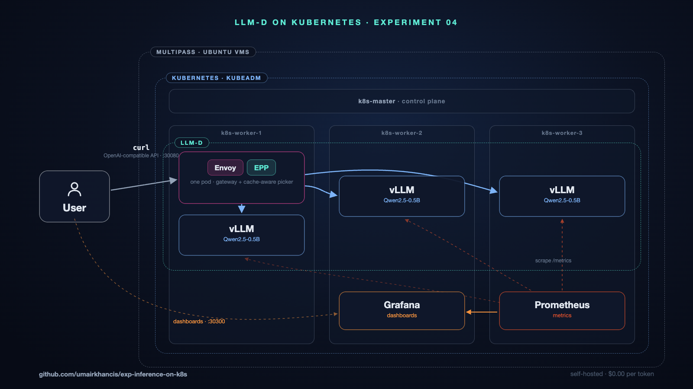
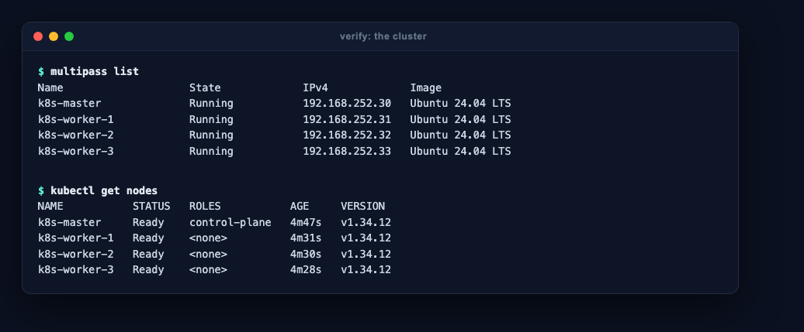
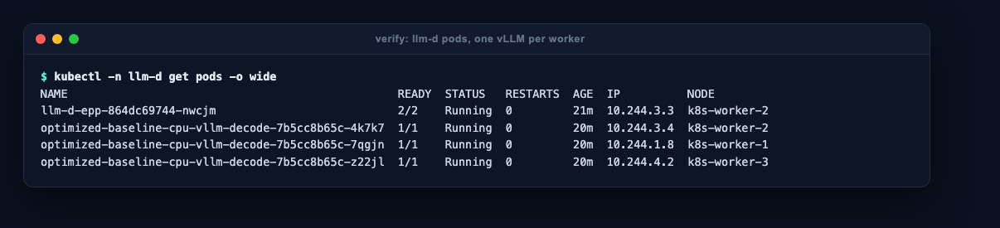
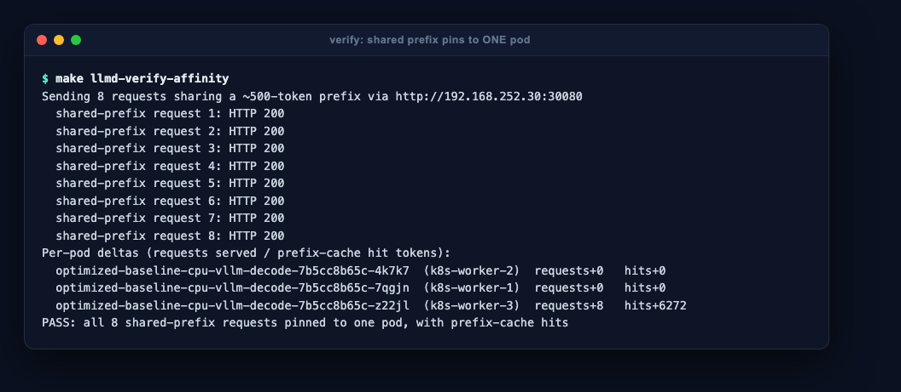
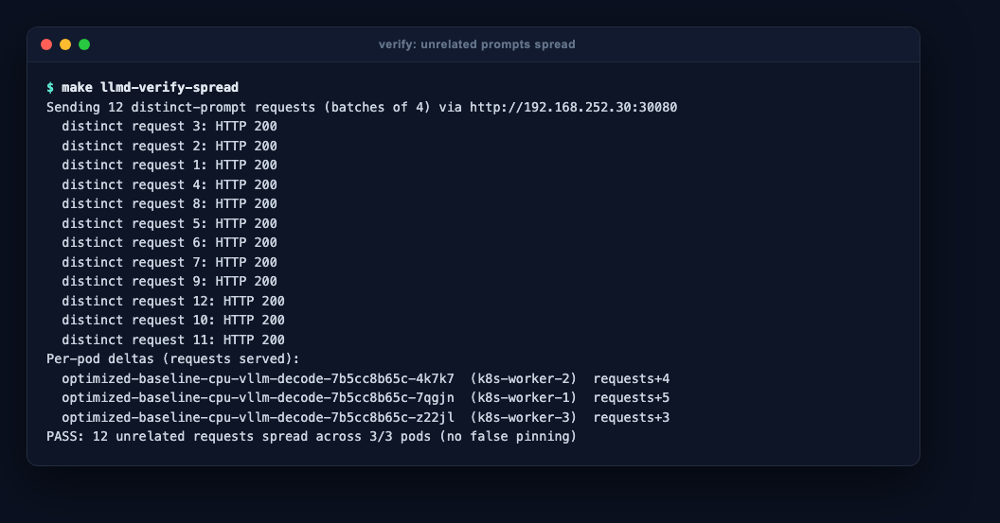
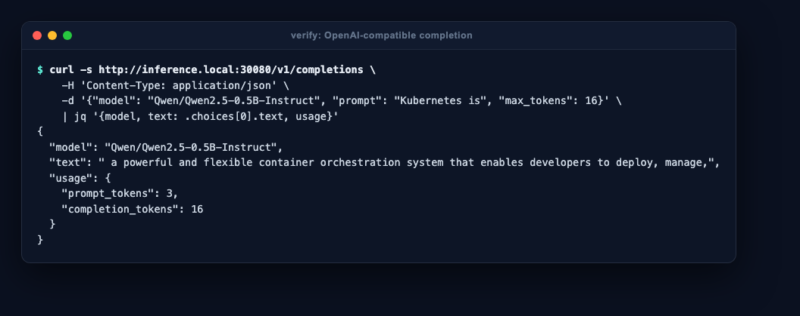
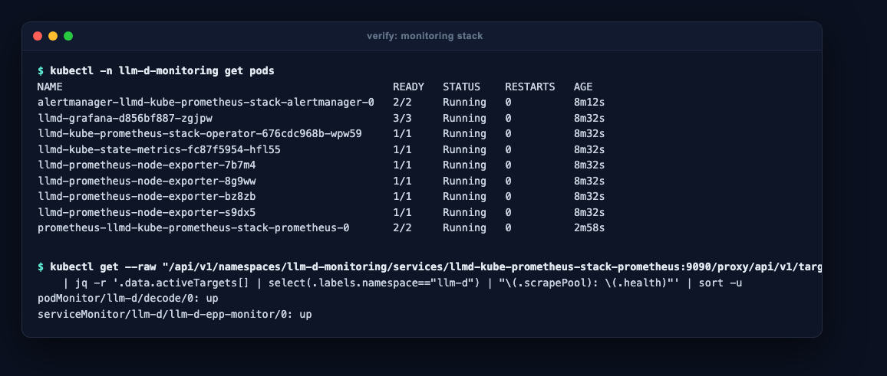
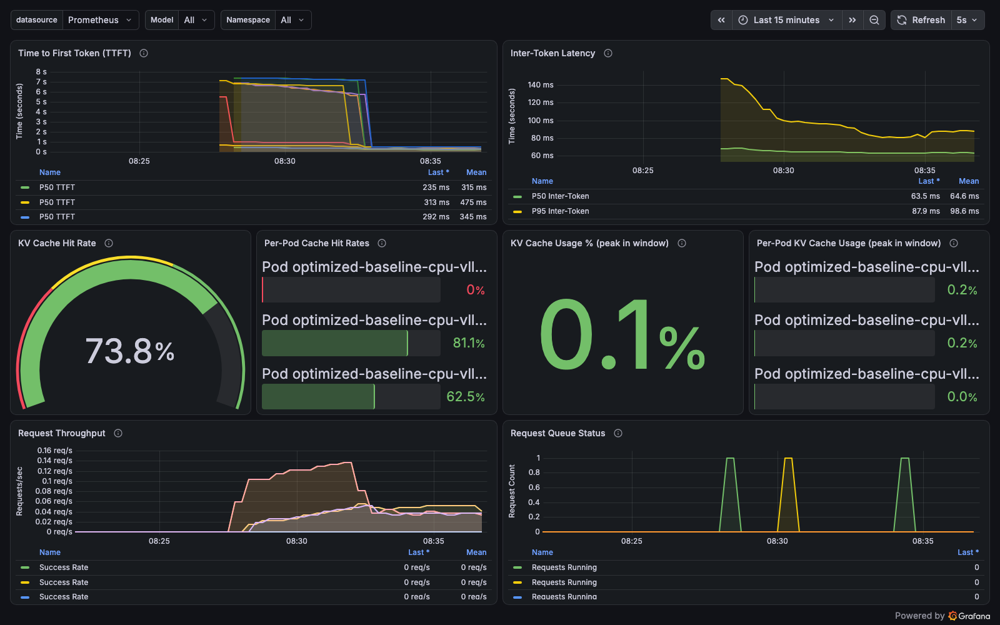
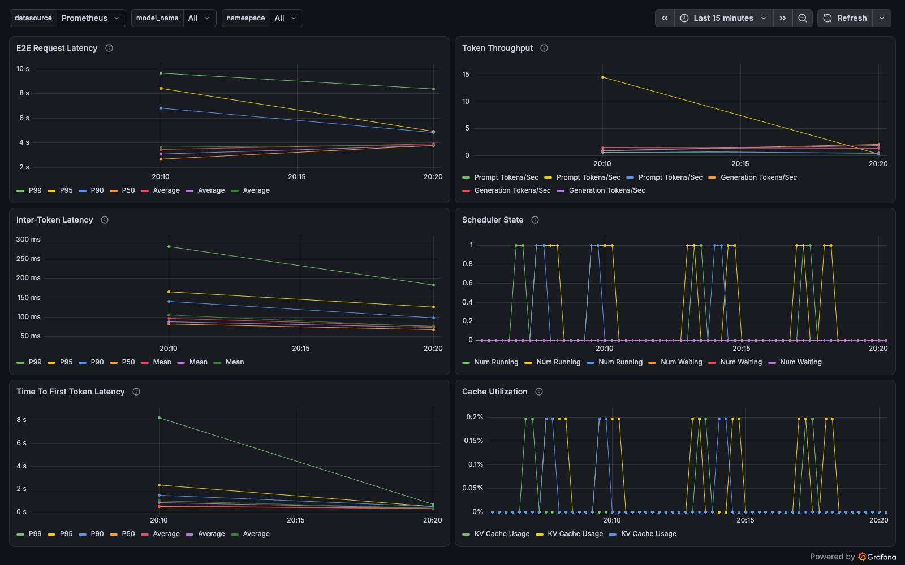

# Experimenting Distributed LLM inference on K8s cluster

A fleet of 3 vLLM servers behind llm-d's cache-aware router (Envoy + EPP),
on a 4-node kubeadm cluster in Multipass VMs; one OpenAI-compatible API,
with Prometheus + Grafana.

## Simple Architecture View


## Full Architecture View


**Requires:** Apple Silicon Mac, 24GB RAM, ~40GB disk, [Homebrew](https://brew.sh).
Everything else is installed for you; all compute stays inside the VMs.

## Quick setup — one command

```sh
curl -fsSL https://raw.githubusercontent.com/umairkhancis/exp-inference-on-k8s/main/install.sh | bash
```

~45–60 min on first run. May prompt once for your password (`/etc/hosts`
entry, Multipass install). Safe to rerun — every layer is idempotent.

## Manual setup — step by step

```sh
git clone https://github.com/umairkhancis/exp-inference-on-k8s.git
cd exp-inference-on-k8s

make host-prereqs       # 1. dependencies + Ubuntu image
make up                 # 2. Kubernetes cluster (VMs -> kubeadm -> CNI -> verify)
make llmd-up            # 3. llm-d: gateway + EPP + vLLM fleet + routing proofs
make llmd-monitoring    # 4. Prometheus + Grafana
```

## Use it

```sh
curl -s http://inference.local:30080/v1/completions \
  -H 'Content-Type: application/json' \
  -d '{"model": "Qwen/Qwen2.5-0.5B-Instruct", "prompt": "Kubernetes is", "max_tokens": 32}' | jq
```

- Grafana: `http://inference.local:30300` (admin/admin) · Prometheus: `:30090`
- kubectl: `export KUBECONFIG=$(pwd)/kubeconfig/config`

## Prove the routing

```sh
make llmd-verify-affinity   # 8 shared-prefix requests -> ONE pod, with cache hits
make llmd-verify-spread     # 12 unrelated requests    -> spread across the fleet
```

## Tear down

```sh
make llmd-down && make down
```

## Deepdive verification

Doing the manual setup? Verify each milestone before moving to the next.
Every screenshot below is the expected output, captured from a real
from-scratch run.

### 1. After `make up` — a real cluster is running

Four VMs on your Mac, four Ready nodes inside them:

```sh
multipass list
kubectl get nodes        # export KUBECONFIG=$(pwd)/kubeconfig/config first
```



Confidence check: all 4 VMs `Running`, all 4 nodes `Ready`, master is the
only `control-plane`. (`kubectl get pods -A` should show every pod Running.)

### 2. After `make llmd-up` — the fleet is placed correctly

```sh
kubectl -n llm-d get pods -o wide
```



Confidence check: the router (`llm-d-epp`, 2/2 — Envoy + EPP in one pod) plus
exactly one vLLM pod per worker node. That placement is enforced by pod
anti-affinity: this is a fleet, not replicas piled on one node.

### 3. The routing claims — prove them from outside the cluster

`make llmd-up` already ran these; rerun them any time:

```sh
make llmd-verify-affinity
```



Confidence check: all 8 requests land on ONE pod (`requests+8`) and that pod
reports thousands of prefix-cache hit tokens — the router recognized the
shared prefix and kept sending you to the pod that already computed it.

```sh
make llmd-verify-spread
```



Confidence check: 12 unrelated requests spread across all 3 pods — no false
pinning; with nothing to cache, it load-balances.

### 4. The API — one curl from your Mac

```sh
curl -s http://inference.local:30080/v1/completions \
  -H 'Content-Type: application/json' \
  -d '{"model": "Qwen/Qwen2.5-0.5B-Instruct", "prompt": "Kubernetes is", "max_tokens": 16}' \
  | jq '{model, text: .choices[0].text, usage}'
```



Confidence check: a completion comes back with token usage — the OpenAI
protocol, served by your own fleet. Point any OpenAI SDK at
`http://inference.local:30080/v1`.

### 5. After `make llmd-monitoring` — the stack is observed

```sh
kubectl -n llm-d-monitoring get pods
```



Confidence check: Prometheus, Grafana, Alertmanager and the exporters all
Running, and both llm-d scrape targets (`llm-d-epp` and the `decode` pods)
report `up` — Prometheus is really pulling metrics from the fleet.

### 6. Grafana — watch the routing live

Open `http://inference.local:30300` (admin/admin), send some traffic
(step 3 works), and open the **llm-d Performance Dashboard**:



The per-pod cache hit rates tell the whole story in one glance: pods that
served shared-prefix traffic sit at 60–80% KV-cache hit rate while a pod
that only saw unique prompts sits at 0% — cache-aware routing, visible on a
graph. (The KV-cache *usage* panels show the peak over the selected time
window, so they read non-zero even after a burst of traffic has finished.)

**llm-d vLLM Overview** shows the fleet's vitals — latency percentiles,
token throughput, scheduler state and cache utilization per pod:



At this point you have verified every layer yourself: VMs → cluster →
fleet placement → routing behavior → API → metrics. That is the whole stack.
