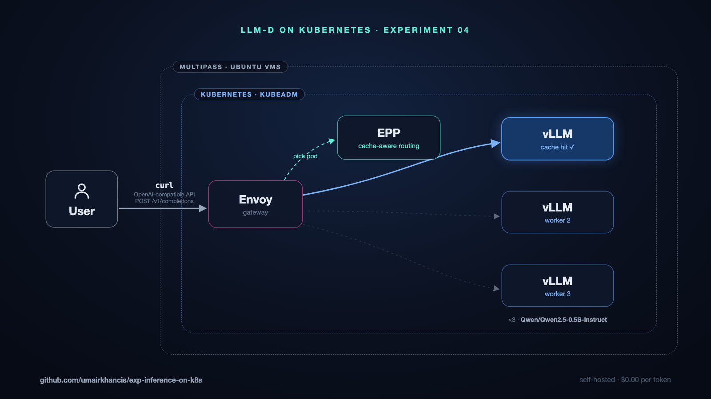

# Distributed LLM inference on your laptop

Run the serving architecture the big labs use — a fleet of model servers behind
a smart router — on a real Kubernetes cluster, entirely on your Mac:

- **4-node Kubernetes cluster** (kubeadm) on isolated Ubuntu VMs (Multipass)
- **[llm-d](https://llm-d.ai)**: an Envoy gateway whose Endpoint Picker (EPP)
  routes each request by **KV-cache affinity** — same prompt prefix, same pod,
  no recompute
- **3 × vLLM** replicas serving `Qwen/Qwen2.5-0.5B-Instruct` behind one
  OpenAI-compatible API
- **Prometheus + Grafana** dashboards for the whole thing



## What you need

- A Mac with **Apple Silicon**, **24GB RAM**, **~40GB free disk**
- [Homebrew](https://brew.sh)

Everything else ([Multipass](https://canonical.com/multipass), jq, kubectl,
helm, helmfile, yq, the Ubuntu image, the llm-d charts) is installed for you —
installing Multipass may prompt once for your password. Nothing computes on
your Mac itself — it all lives in the VMs, and `make down` removes every trace.

## Install

```sh
curl -fsSL https://raw.githubusercontent.com/umairkhancis/exp-inference-on-k8s/experiment/04/install.sh | bash
```

That one command clones the repo (into `./exp-inference-on-k8s`) and brings up
the whole stack. First run takes ~45–60 min (Ubuntu image + model downloads).
Already cloned? `./install.sh` does the same from inside the repo.

Every layer is idempotent: if anything fails (a flaky download, a timeout),
just run it again — finished layers skip themselves.

Prefer to watch it happen in stages?

```sh
make up                 # the Kubernetes cluster
make llmd-up            # gateway + EPP + vLLM fleet (ends by verifying routing)
make llmd-monitoring    # Prometheus + Grafana
```

## Use it

The install prints your master node's IP (something like `192.168.252.21`).

**Call the API** — it speaks the OpenAI protocol, so point any SDK at it:

```sh
curl -s http://<master-ip>:30080/v1/completions \
  -H 'Content-Type: application/json' \
  -d '{"model": "Qwen/Qwen2.5-0.5B-Instruct", "prompt": "Kubernetes is", "max_tokens": 32}' | jq
```

**Watch the dashboards** — `http://<master-ip>:30300` (admin/admin): request
rates, latency, prefix-cache hit rates, per-pod load.

**Drive the cluster** — `export KUBECONFIG=$(pwd)/kubeconfig/config`, then
`kubectl -n llm-d get pods -o wide` shows the fleet, one vLLM per worker.

## See the routing for yourself

The interesting claim is the routing, so prove it on your machine:

```sh
make llmd-verify-affinity   # 8 requests sharing a prefix -> ONE pod, with cache hits
make llmd-verify-spread     # 12 unrelated requests       -> spread across the fleet
```

Each prints a per-pod table of served requests and prefix-cache hits, and fails
loudly if the claim doesn't hold.

## Tune it

All knobs are environment variables — see `scripts/setup-k8s-cluster/lib/common.sh`
and `scripts/setup-llm-d/lib/common.sh` for the full list. The useful ones:

```sh
WORKER_COUNT=2 make up            # fewer workers (e.g. on a 16GB machine)
WORKER_MEM=8G make llmd-resize-workers
LLMD_MODEL=... REQUESTS=20 make llmd-verify-affinity
```

## Tear down

```sh
make llmd-down   # remove llm-d, keep the cluster
make down        # delete the VMs and kubeconfig (cached downloads are kept)
```

## If something goes wrong

- **Rerun the same command.** Every layer checks what already exists.
- `make status` shows the VMs and nodes at a glance.
- Node provisioning logs land in `.logs/<node>-prereqs.log`.
- First boot of the vLLM pods downloads ~1GB of weights each; the rollout
  waits up to 30 minutes before giving up.
- The Ubuntu image is fetched with curl and SHA-verified because `multipassd`'s
  own downloader truncates large downloads on some Macs; a stale cached image
  is re-downloaded automatically.

## How it's organized

```
install.sh                    # everything, one command
Makefile                      # all targets (make <tab> to explore)
scripts/setup-k8s-cluster/    # phase 1: host prereqs -> VMs -> kubeadm -> CNI -> verify
scripts/setup-llm-d/          # phase 2: llm-d router + vLLM fleet + monitoring + proofs
docs/                         # publish posts and graphics
```

Both phases follow the same pattern: small single-purpose layers you can run
(and rerun) independently, orchestrated by make. The llm-d deployment follows
the [official quickstart](https://llm-d.ai/docs/getting-started/quickstart)
from a pinned `release-1.0` clone, with this repo contributing only the
small-node/ARM64 overrides (`scripts/setup-llm-d/values/`, `manifests/`).
