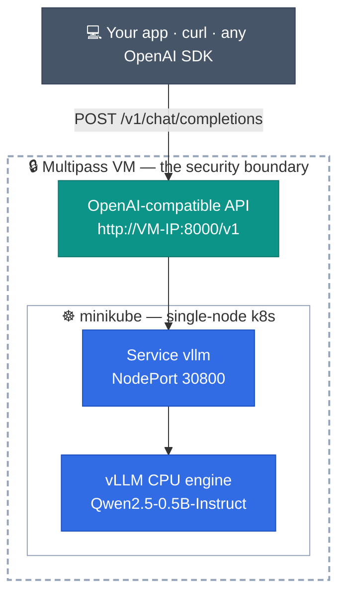

# Experimenting LLM inference on K8s cluster

Own your inference layer: vLLM on a Kubernetes cluster,
serving an OpenAI-compatible API at a flat rate — instead of
per-token bills from frontier labs.

This experiment runs fully sandboxed in a Multipass VM on your
laptop: hassle-free learning, nothing installed on your host.



## Quick start (one command)

```bash
curl -sfL https://raw.githubusercontent.com/umairkhancis/exp-inference-on-k8s/main/install.sh | bash
```

**Note:** ~10–20 minutes on first run (image pull + model download). At the end you get an endpoint like `http://192.168.64.X:8000/v1`.

## Concerned about trying it on local machine?

Run each step yourself:

```bash
# 1. Install Multipass by Canonical to launch Ubuntu VMs on demand on any workstation fully isolated
./scripts/01-install-multipass.sh

# 2. Create an Ubuntu VM (fully sandbox environment) and log into its shell
./scripts/02-create-instance.sh

# 3. Inside the VM shell: spin up minikube + the vLLM stack
./inference/03-setup-stack.sh
```

## Verification (from your host machine)

```bash
# From the repository root
cd path/to/exp-inference-on-k8s

./verify/curl-check.sh      # chat completion round-trip through the stack
./verify/metrics-check.sh   # vLLM Prometheus /metrics performance numbers
./verify/load-test.sh       # 10 parallel simulated developers, latency + tok/s
```

Point any OpenAI SDK at it by changing one line:

```python
from openai import OpenAI

client = OpenAI(base_url="http://<vm-ip>:8000/v1", api_key="local")
r = client.chat.completions.create(
    model="Qwen/Qwen2.5-0.5B-Instruct",
    messages=[{"role": "user", "content": "Hello from my own infra"}],
)
print(r.choices[0].message.content)
```

## Notes on the stack

- **CPU inference, on purpose.** Multipass on Apple Silicon cannot pass the
  GPU through to a Linux VM, so the pod runs a multi-arch CPU build of vLLM
  ([`mekayelanik/vllm-cpu`](https://hub.docker.com/r/mekayelanik/vllm-cpu)).
  A 0.5B model keeps it interactive. 
- **minikube** (docker driver) is the k8s layer.
- **Metrics are native.** vLLM exposes Prometheus metrics on the same port
  (`/metrics`): token counters, TTFT, E2E latency, KV-cache usage.

## Measured on this stack (Apple M5 Pro host, 4-CPU/8G VM)

- 10 parallel developers for 60s: **49/49 requests OK**, ~35 tok/s
  sustained, p50 latency 12.2s at full saturation (`max_tokens=64`).
- Single request: ~0.4s time-to-first-token, ~1.5s end-to-end.

## Teardown

```bash
multipass delete --purge $(whoami)-inference-engine
```
